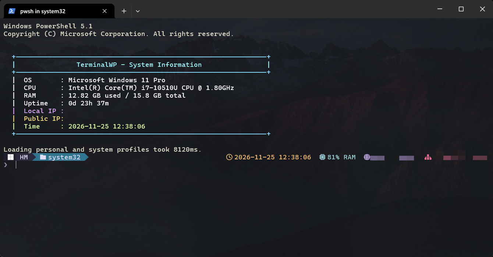

# TerminalWindows - Windows Terminal / PowerShell UI

## How it looks



A customized Windows Terminal + PowerShell setup: mountain wallpaper with acrylic blur,
directory icons, and a right-aligned panel showing date & time, RAM usage, local IP and
public IP (each in a different color). Includes a startup system-information banner.

## Contents

- `settings.json` - Windows Terminal settings (background image, opacity, color scheme, font)
- `Microsoft.PowerShell_profile.ps1` - PowerShell profile (oh-my-posh, Terminal-Icons, banner)
- `theme.omp.json` - oh-my-posh theme (right-aligned date/time, RAM, local IP, public IP)
- `Install-TerminalWP.ps1` - one-click installer
- `screenshot.png` - preview

## Wallpaper folder

The wallpaper is stored in `%USERPROFILE%\TerminalWP\` (folder named `TerminalWP`).

## Install

```powershell
Set-ExecutionPolicy -Scope CurrentUser RemoteSigned
.\Install-TerminalWP.ps1
oh-my-posh font install CascadiaCode
```

Then set the Windows Terminal font to `CaskaydiaCove Nerd Font` and restart the terminal.
